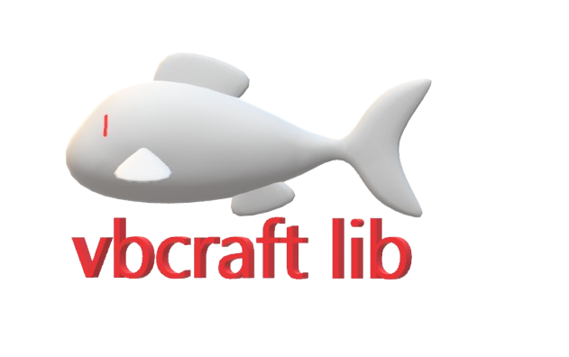

# Visual Basic Mod Manager for Minecraft
A Visual Basic application for managing Minecraft mods, installing and removing files, organizing mod folders, and switching between different mod setups. It is designed to help players keep their game configuration clean, safe, and easy to maintain.


## C++ console mod manager

`main.cpp` is a separate console app for **Minecraft: Java Edition**. It manages Java mod `.jar` files and defaults to `%APPDATA%\.minecraft\mods`; use **Choose mods folder** for another Java installation or launcher instance. Bedrock add-ons use different formats and are not supported by this app.

Build and run it from PowerShell with a C++17 compiler such as MinGW:

```powershell
g++ main.cpp -std=c++17 -o minecraft-java-mod-manager-bulk.exe -lshell32
.\minecraft-java-mod-manager-bulk.exe
```

The app scans `.jar` files in the selected folder, installs a JAR from a path you provide, and enables or disables mods by renaming files to or from `.jar.disabled`. **Install folder of mods and open Modded Java** copies `.jar` files directly from a folder you choose into the selected mods folder, enables all recognized mods, lists the enabled JAR filenames in the console, then opens the registered **Minecraft Launcher** app (not the Store or Bedrock app). In the Launcher, select your NeoForge installation and click **Play**. NeoForge reports loaded mods in the game's Mods screen; the Launcher itself does not show the loaded mod list. Make sure the selected mods folder belongs to that installation; launcher profiles can use a custom game directory. **Run Vanilla Java** disables every recognized mod JAR. **Run Modded Java** enables every recognized mod JAR, including ones previously disabled individually. Removal permanently deletes the selected file and requires confirmation. The app does not download mods or check Minecraft/loader compatibility; use mods made for your Minecraft version and NeoForge version.
